# AmperiaSTEM

[Українська версія](README.md)

**AmperiaSTEM** is an Arduino library for working with EdPro Amperia STEM educational equipment using **Arduino UNO R4 WiFi** and the **EdPro Amperia Shield**. The **Arduino UNO R4 WiFi** board is included in the Amperia STEM kit.

With this library, an Arduino can:

- read connected Amperia STEM sensors;
- create custom sensors and send their measurements to the Amperia Multimeter;
- process, transform, and combine measurements;
- control actuators connected to the EdPro Amperia Shield.

The library is designed for educational use: common tasks should require as little boilerplate code as possible. For more advanced applications, a lower-level API is available for working with metadata, data types, and individual logical sensors.

## Related EdPro products

- **[EdPro Amperia](https://edpro-ua.translate.goog/amperia?_x_tr_sl=uk&_x_tr_tl=en&_x_tr_hl=en)** — a family of educational kits for laboratory experiments and classroom demonstrations in physics, including electricity and magnetism and mechanics.
- **[EdPro Amperia STEM](https://edpro-ua.translate.goog/amperia/amp-stem?_x_tr_sl=uk&_x_tr_tl=en&_x_tr_hl=en)** — the “Electronics, Robotics and Sensors” kit, which extends the Amperia ecosystem with sensors, electronic components, and tools for working with Arduino and robotics. AmperiaSTEM is being developed specifically for working with this equipment.

## Supported Arduino platform

The library currently supports **Arduino UNO R4 WiFi** with the **EdPro Amperia Shield**.

| 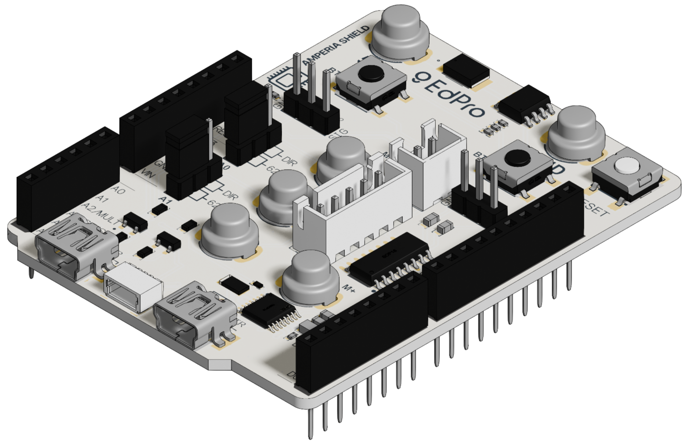 | 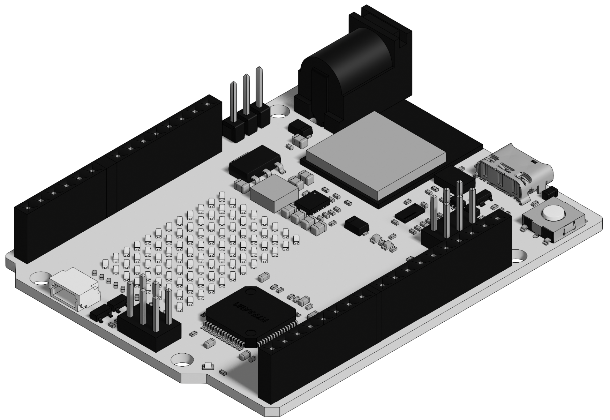 |
| --- | --- |
| EdPro Amperia Shield | Arduino UNO R4 WiFi |

Other Arduino-compatible boards are not currently supported; support for them is under development.

## How everything is connected

A typical configuration allows Arduino to simultaneously read an external Amperia STEM sensor and other connected sensors, control actuators such as motors, process measurements, and send the results to the multimeter.

| 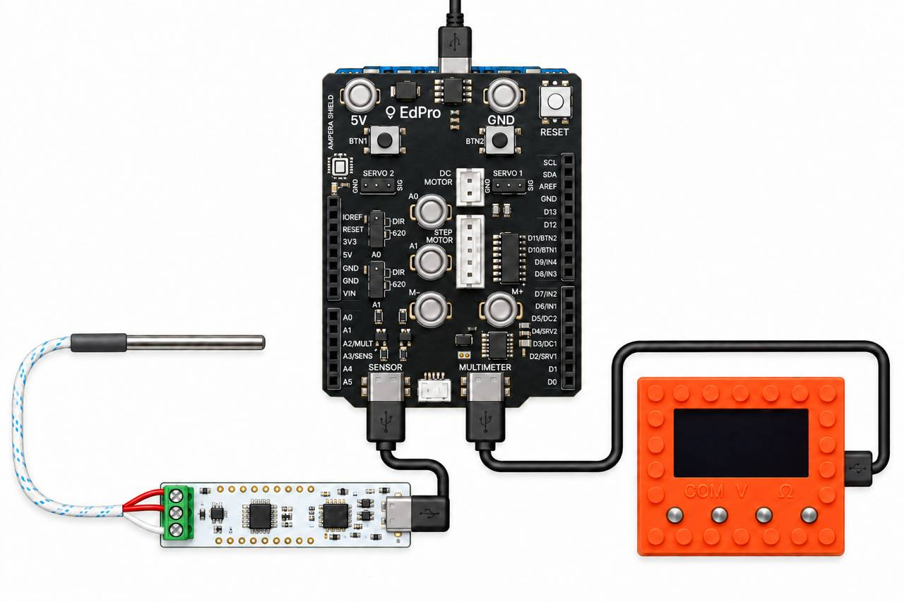 |
| --- |
| Typical connection. |

On Arduino UNO R4 WiFi with the EdPro Amperia Shield:

- `Wire` is used to read the external Amperia STEM sensor;
- `A3` is the DREADY signal from the external sensor;
- `Wire1` is used to communicate with the Amperia Multimeter;
- `A2` is the DREADY signal to the multimeter.

The `Wire1` (I²C) bus is routed to the shield through the Qwiic connection between Arduino UNO R4 WiFi and the EdPro Amperia Shield and is used to communicate with the multimeter. The DREADY signals are carried on separate lines: `A3` from the external sensor to Arduino, and `A2` from Arduino to the multimeter.

| 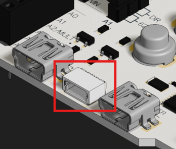 |
| --- |
| Arduino UNO R4 WiFi Qwiic connector. The Qwiic connectors of the Arduino UNO R4 WiFi and the EdPro Amperia Shield **must be connected with a Qwiic cable**. |

## Mechanical connection of the boards

Disconnect Arduino from power before installation. Align the male headers of the EdPro Amperia Shield with the corresponding female headers of the Arduino UNO R4 WiFi. Carefully install the shield without tilting it and press it evenly until the connectors are fully seated. Then connect the Qwiic connectors on the shield and the Arduino UNO R4 WiFi with a Qwiic cable. This connection routes the `Wire1` bus to the shield, which is required for data exchange with the Amperia Multimeter.

| 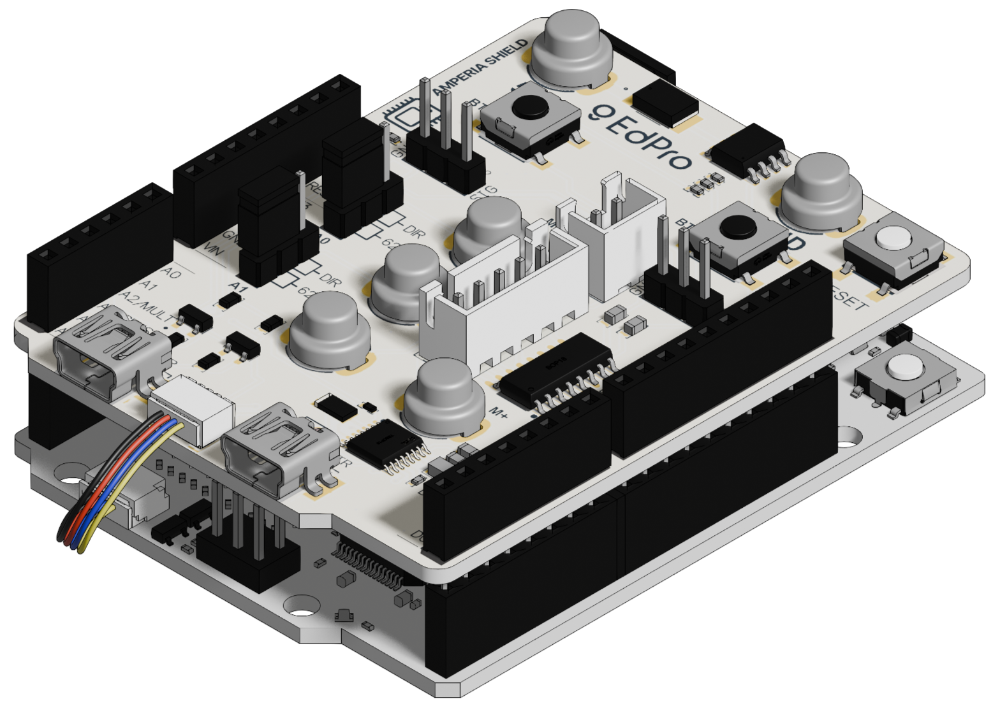 |
| --- |
| Connecting the boards. |

| 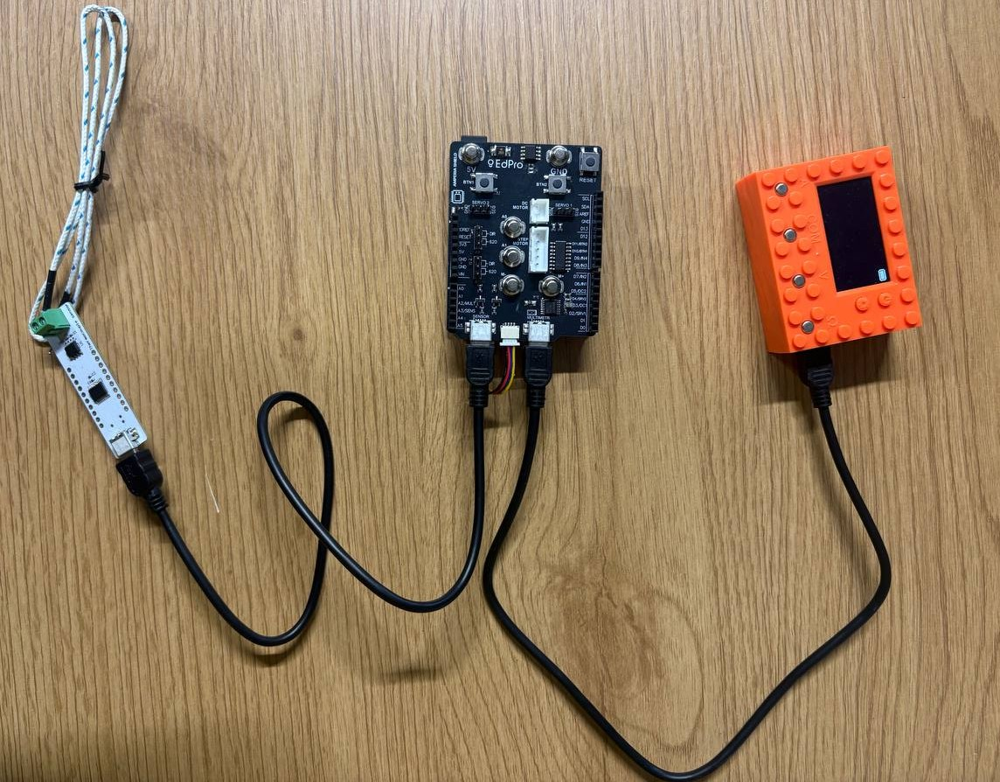 |
| --- |
| Assembled setup for the first experiment. |

## EdPro Amperia Shield layout

|  |
| --- |
| EdPro Amperia Shield. |

The board contains the following main functional blocks:

| 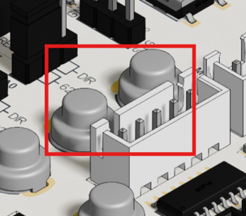 | 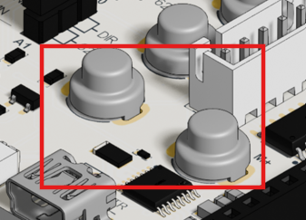 |
| :---: | :---: |
| **Analog terminals (`A0`, `A1`)**: large round magnetic contacts connected to the Arduino `A0` and `A1` analog inputs. Intended for convenient connection of measurement circuits and kit components. | **DC motor terminals (`M+`, `M−`)**: large round magnetic contacts for connecting a DC motor to the motor driver output. |
| 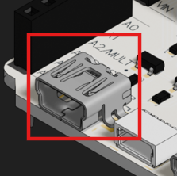 | 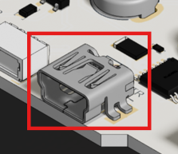 |
| **`SENSOR`**: connector for an external Amperia STEM sensor. | **`MULTIMETR`**: connector for the Amperia Multimeter and data exchange with it. |
| 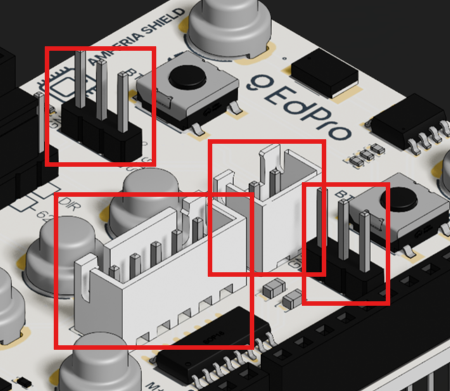 | 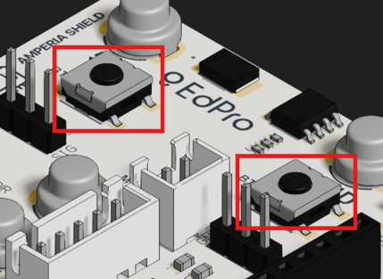 |
| Stepper motor and two servo motor connectors. | **User buttons (`BTN1`, `BTN2`)**: two buttons for manual control, for example starting and stopping data collection during an experiment (connected to `D10` and `D11`). The board also has a **RESET** button for restarting the Arduino UNO R4 WiFi. |

**Motor connectors**:
   * **DC MOTOR**: connector for a DC motor (controlled through `D3/DC1`, `D5/DC2`).
   * **STEP MOTOR**: connector for a stepper motor (controlled through `D6/IN1`, `D7/IN2`, `D8/IN3`, `D9/IN4`).
   * **SERVO 1 / SERVO 2**: connectors for servo motors (controlled through `D2/SRV1`, `D4/SRV2`).

| 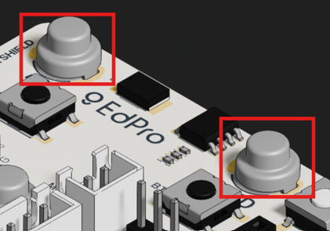 |
| --- |
| **Power terminals (`5V`, `GND`)**: magnetic contacts for supplying power and a common ground connection to external circuits. |

## Installation

After AmperiaSTEM is published in the **Arduino Library Manager**, it will be possible to install it directly from the Arduino IDE by searching for `AmperiaSTEM` in the Library Manager.

While the library is under development, it can also be installed from this repository:

1. Install Arduino IDE or Arduino CLI.
2. Install the **Arduino UNO R4 Boards** platform package.
3. Download this repository as a ZIP and add it through **Sketch → Include Library → Add .ZIP Library...**, or copy the repository into the Arduino `libraries` directory.
4. Select **Arduino UNO R4 WiFi** as the target board.

The core library uses the standard Arduino `Stepper` and `Servo` libraries. Individual examples may require additional libraries; in particular, `04_TemperatureSensor`, `05_AgentTemperatureSensor`, `09_ForwardSensorWithDHT11`, and `16_MultipleDHTValues` use `DHT sensor library`, while `17_CombinedMPU6050` uses the `I2Cdev` and `MPU6050` libraries. Depending on the selected sensor, [`TestingSensors`](extras/manual-tests/TestingSensors/TestingSensors.ino) may require the corresponding sensor library.

## Your first custom sensor

The following is a shortened version of [`03_CreateAnalogSensor`](examples/03_CreateAnalogSensor/03_CreateAnalogSensor.ino). Arduino reads an analog signal from `A0`, converts it to a percentage, and sends the result to the Amperia Multimeter.

```cpp
#include <AmperiaSTEM.h>

SimpleSensor analogSensor(
    "Student sensor",
    "Analog level",
    "%"
);

void setup()
{
    analogReadResolution(12);
    analogSensor.begin();
}

void loop()
{
    float level = 100.0f * analogRead(A0) / 4095.0f;

    analogSensor.publish(level);

    delay(160);
}
```

The full example also includes initialization checks and diagnostic output through `Serial`.

For example, the analog signal can be supplied using the rheostat included in the Amperia kit.

## Library overview

The library has three main areas of functionality:

- Sending measurements and results of Arduino-side processing to the multimeter.
- Reading EdPro Amperia STEM sensors connected to the shield.
- Controlling actuators connected to the shield.

### Arduino → Amperia Multimeter

For sending measurements and results of Arduino-side processing to the multimeter, the library provides the following classes:

- `SimpleSensor` — one logical sensor with one value;
- `AgentSensor` — a one-dimensional sensor whose measurement is obtained through a supplied function, a simplified variant of the previous class;
- `NDimSensor` — one logical sensor with several homogeneous components, for example X/Y/Z;
- `NSensors` — several one-dimensional logical sensors;
- `CombinedSensor` — several logical sensors, including sensors of different dimensions.

For sensors that Arduino exposes to the multimeter, `set(...)` changes the prepared value without publishing it, while `publish()` publishes the current snapshot. For `SimpleSensor`, the short form `publish(value)` performs both operations at once.

For simple educational tasks, `SimpleSensor` or `NDimSensor` is usually sufficient.

If one device contains several one-dimensional quantities with different units, use `NSensors`:

```cpp
NSensors measurements("Weather");

int temperature = measurements.addSensor("Temperature", "C");
int humidity = measurements.addSensor("Humidity", "%");

measurements.begin();

measurements.set(temperature, 23.5f);
measurements.set(humidity, 48.0f);
measurements.publish();
```

If the same device needs logical sensors with different dimensions, use `CombinedSensor`:

```cpp
CombinedSensor measurements("Experiment");

int acceleration =
    measurements.addSensor("Acceleration", "g", "X", "Y", "Z");
int magnitude = measurements.addSensor("Magnitude", "g");

measurements.begin();

measurements.set(acceleration, 0, 0.10f);
measurements.set(acceleration, 1, 0.20f);
measurements.set(acceleration, 2, 0.95f);
measurements.set(magnitude, 0.98f);
measurements.publish();
```

`addSensor()` returns an identifier (handle) for a logical sensor, which can then be passed to `set()`. Before calling `begin()`, `setDataPeriodMs(handle, periodMs)` can be used to specify the update period that the sensor reports to the multimeter. The actual measurement timing is controlled by the program code. `begin()` finalizes the configuration automatically.

Full examples: [`16_MultipleDHTValues`](examples/16_MultipleDHTValues/16_MultipleDHTValues.ino) and [`17_CombinedMPU6050`](examples/17_CombinedMPU6050/17_CombinedMPU6050.ino).

### Amperia STEM sensor → Arduino

`AmperiaSensorClient` is used when Arduino reads an external Amperia STEM sensor. It discovers the available logical sensors and reads their metadata and current values without being tied to a specific sensor model.

For specific educational tasks, the library may also provide more convenient specialized operations on top of this mechanism.

### Actuators

For controlling actuators connected to the EdPro Amperia Shield, the library provides several simple classes:

- `AmpDC` — control the direction and speed of a DC motor.
- `AmpServo` — control a servo motor, including setting an absolute angle and rotating relative to the current position.
- `AmpStepper` — control a stepper motor in steps or degrees at a specified speed.

By default, these classes use the corresponding connectors and pins on the EdPro Amperia Shield, so pins do not need to be specified for typical educational tasks.

Usage examples: [`13_DCMotorUsage`](examples/13_DCMotorUsage/13_DCMotorUsage.ino), [`14_ServoMotorUsage`](examples/14_ServoMotorUsage/14_ServoMotorUsage.ino), and [`15_StepperMotorUsage`](examples/15_StepperMotorUsage/15_StepperMotorUsage.ino).

## Examples

Examples are located in the [`examples`](examples/) directory. The recommended approach is to start with the simpler examples and move on to the generic API and combining sensors only when needed.

| Example | What it demonstrates | Level |
| --- | --- | --- |
| `01_GettingStarted` | basic use of a ready-made Amperia STEM sensor | beginner |
| `02_ListSensors` | automatic discovery of logical sensors and reading their metadata | intermediate |
| `03_CreateAnalogSensor` | creating a custom one-dimensional sensor | beginner |
| `04_TemperatureSensor` | using DHT11 as a custom temperature sensor for the multimeter | beginner |
| `05_AgentTemperatureSensor` | automatic measurement through `AgentSensor` and a callback function | advanced |
| `06_GateSensor` | reading a gate sensor and forwarding selected measurements | beginner |
| `07_FourPinStateSensor` | creating a custom multi-component sensor | beginner |
| `08_ForwardSensorToMultimeter` | generic forwarding of an external sensor to the multimeter | advanced |
| `09_ForwardSensorWithDHT11` | combining an external Amperia STEM sensor with a local DHT11 | advanced |
| `10_IfElseCondition` | reacting to a measured value using `if` / `else` | beginner |
| `11_VectorCalibration` | calibration and processing of a vector measurement | intermediate |
| `12_KinematicsSpeed` | calculating a new physical quantity from measured data | beginner |
| `13_DCMotorUsage` | controlling a DC motor | beginner |
| `14_ServoMotorUsage` | controlling a servo motor | beginner |
| `15_StepperMotorUsage` | controlling a stepper motor | beginner |
| `16_MultipleDHTValues` | several scalar quantities through `NSensors` | intermediate |
| `17_CombinedMPU6050` | a vector and a scalar in one device through `CombinedSensor` | intermediate |

Additional material is kept outside `examples/`: [`TestingSensors`](extras/manual-tests/TestingSensors/TestingSensors.ino) is intended for manually testing different sensor configurations, while [`AllFeaturesReference`](extras/reference/AllFeaturesReference/AllFeaturesReference.ino) is an extended reference sketch. They are not part of the regular set of educational examples.

Recommended learning path for a first introduction:

```text
01_GettingStarted
        ↓
03_CreateAnalogSensor
        ↓
04_TemperatureSensor
        ↓
06_GateSensor / 07_FourPinStateSensor
        ↓
10_IfElseCondition / 12_KinematicsSpeed
        ↓
08_ForwardSensorToMultimeter / 09_ForwardSensorWithDHT11
        ↓
16_MultipleDHTValues / 17_CombinedMPU6050
```

Examples `16_MultipleDHTValues` and `17_CombinedMPU6050` demonstrate the lower-level generic API for several logical sensors and are best approached after the simpler `SimpleSensor` and `NDimSensor` examples.

Examples `13_DCMotorUsage`–`15_StepperMotorUsage` can be explored separately when actuator control is needed.

## Development and validation

Three scripts are used for local validation of the library:

- `scripts/compile-examples.sh` — compiles all educational examples or selected ones;
- `scripts/compile-testing-sensors-matrix.sh` — compiles `TestingSensors` for every supported configuration and restores the file afterwards;
- `scripts/validate-library.sh` — runs the complete pre-release validation: examples, the `TestingSensors` matrix, `AllFeaturesReference`, Arduino Lint, and `git diff --check`.

Common commands:

```bash
./scripts/compile-examples.sh --clean
./scripts/compile-examples.sh --clean 17_CombinedMPU6050
./scripts/compile-testing-sensors-matrix.sh
./scripts/validate-library.sh
```

On a clean environment, example dependencies can be installed automatically:

```bash
./scripts/validate-library.sh --install-deps
```

Additional options for each script are available through `--help`.

## Current limitations

- only Arduino UNO R4 WiFi with the EdPro Amperia Shield is currently supported;
- one Amperia device can describe up to **5 logical sensors**;
- one logical sensor can contain up to **4 components**;
- using no more than **3 components** per logical sensor is recommended for the current multimeter UI, because the fourth component is displayed less conveniently;
- the API and examples are still evolving and may change before the first stable release.

## Library structure

For normal use, including a single header is sufficient:

```cpp
#include <AmperiaSTEM.h>
```

Main parts of the repository:

- `src/` — library implementation;
- `src/client/` — reading external Amperia STEM sensors;
- `src/protocol/` — protocol definitions and register encoding;
- `src/device/` — exposing Arduino as an Amperia device;
- `src/internal/motors/` — internal actuator implementations;
- `examples/` — educational examples;
- `extras/manual-tests/` — manual test sketches;
- `extras/reference/` — extended reference sketches;
- `scripts/` — helper scripts for development and verification.

## License

Copyright 2026 EdPro.

AmperiaSTEM is licensed under the [Apache License 2.0](LICENSE).
